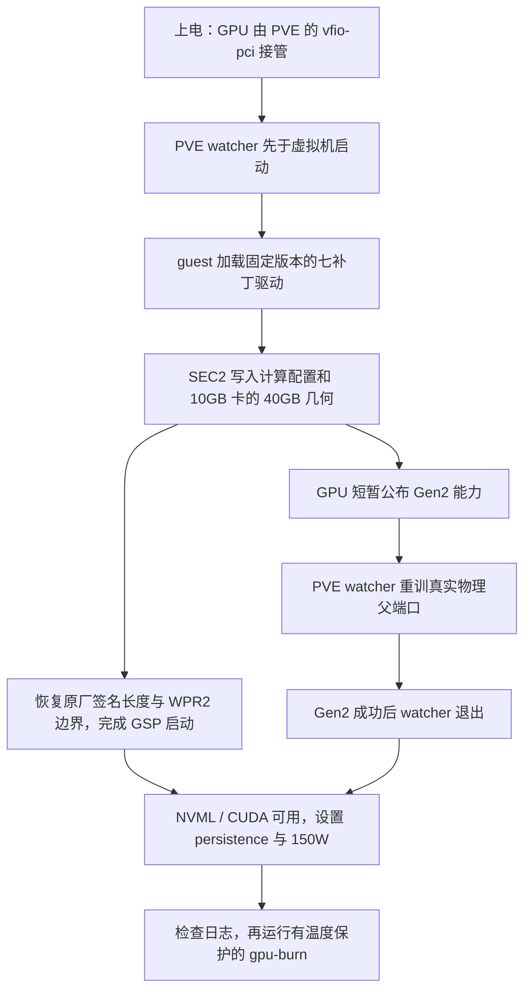

# CMP 170HX 10GB → 40GB：Proxmox VFIO 成功复现记录

仓库：[Ciender/cmp170hx-40gb-proxmox-guide](https://github.com/Ciender/cmp170hx-40gb-proxmox-guide)。

在 **Proxmox VE 8.4.1 → Debian 12 虚拟机** 的 PCIe 直通环境中，使用 Johnnydaboy 的 `homelab-dual-cmp170hx` 分支，将单张 **10de:2082、原始 10GB 的 CMP 170HX** 启动为 **40960 MiB 显存、PCIe Gen2 ×4、70 SM**，并在 **150W 功率限制**下通过 gpu-burn 短时测试。

本仓库记录这条已经成功的路线，包括作者的关键修复、固定源码版本、宿主机和虚拟机配置、构建方法、冷启动顺序，以及实际运行证据。解锁驱动来自上游，本文提供的是这张 10GB 卡在 PVE 下的复现与环境适配。

## 实测结果

验证日期：**2026-11-14**。

| 项目 | 实测结果 |
| --- | --- |
| GPU | NVIDIA CMP 170HX，PCI ID `10de:2082` |
| 原始容量 / 解锁后 NVML 容量 | 10GB / **40960 MiB** |
| CUDA 可见总容量 | **40483.625 MiB**，与 NVML 的差额包含驱动和固件保留空间 |
| CUDA 计算能力 / SM | **8.0 / 70 SM** |
| 物理 PCIe 链路 | **Gen2 ×4，5GT/s**；PVE 的 GPU 及物理父端口均已核验 |
| BAR1 | GPU 物理 ReBAR、PVE 资源、guest 资源均为 **64MiB** |
| 请求 / 生效功率限制 | **150W / 150W** |
| gpu-burn | 参数 120 秒，约 **35.31GiB** 分配，**0 错误，GPU 0: OK** |
| 压测核心最高温度 | **53℃** |
| 温度监控 | 约每 0.25 秒采样；**75℃提前停止**，本次要求核心不超过 78℃ |
| 测试后日志 | 未发现 guest Xid、GSP/BAR2 初始化失败或内核 BUG/Oops；host 错误筛查为空 |
| ECC / 额外 4 SM | ECC 报 `N/A`；没有启用额外 4 SM |

本次是单卡、单次冷启动和 120 秒 gpu-burn 的验证；尚未做长时间稳定性测试，也没有逐地址覆盖全部 40GB 的独立显存测试。gpu-burn 的实际分配量、NVML 总占用量和 CUDA 总容量分别记录，不能互相替代。


图由本次 [525 个监控样本](evidence/2026-11-14/temperature.csv)生成。完整结果见 [验证说明](docs/VALIDATION.zh-CN.md)。

## 目录

- [成功路线及作者修复](#成功路线及作者修复)
- [固定版本和硬件环境](#固定版本和硬件环境)
- [复现前记录设备拓扑](#复现前记录设备拓扑)
- [PVE 宿主机准备](#pve-宿主机准备)
- [虚拟机配置](#虚拟机配置)
- [Debian 虚拟机内构建和安装](#debian-虚拟机内构建和安装)
- [完整冷启动](#完整冷启动)
- [启动后按顺序验收](#启动后按顺序验收)
- [带温度保护的 gpu-burn](#带温度保护的-gpu-burn)
- [后续维护](#后续维护)
- [本仓库内容与发布](#本仓库内容与发布)

## 成功路线及作者修复

上游通用 README 保留了完整 BAR1 等功能介绍，而该分支的 [Proxmox 专用文档](https://github.com/Johnnydaboy/cmpunlocker/blob/658110d5d1f15f7174d18f57caad4cab7d04593a/docs/proxmox-dual-cmp170hx.md)明确采用更窄的 VFIO 路径。这里按照专用文档和实际 `driver/build.sh` 的默认补丁集合操作。



**1. 保持 VFIO 的 BAR1 映射一致。** QEMU 在虚拟机创建时建立 guest BAR 窗口。该分支默认不应用 `bar1-resize-unlock.patch`，避免 guest 驱动通过 GPU 寄存器改变物理 BAR1 后，硬件实际窗口与 QEMU/VFIO 的既有映射发生分歧。本次 40GB 显存启动和计算测试成功时，BAR1 始终是 64MiB；显存容量不要求等量的 BAR1 窗口。

**2. 正确处理 GSP 签名、WPR 元数据与 WPR2。** 作者在固定提交中保留同一个签名内存描述符，恢复原厂签名内容，并把元数据中的签名长度恢复为真实长度。本次日志是 `sigSize=4096`，而不是把 `0xf800` 的 payload 缓冲大小当成签名长度。同时，SEC2 写入结束后恢复保存的 WPR2 硬件边界，再刷新相关元数据。

**3. 精简 VFIO 下的初始化路径。** CMP 卡不采用放松锁的并行 GSP 初始化；默认补丁集合排除 `booter-verify.patch` 和 guest 侧 `pcie-gen2-probe-retrain.patch`。`pcie-gen2.patch` 中与 Gen2 无关的 `FEAT_OVR_ECC_PLM`、地址 `0x00823800` 写入被移除。本次没有重新加入 ECC 配方。

**4. 由 PVE 重训物理链路。** guest 里的 Q35 桥与 PVE 的真实 PCIe 父端口属于不同层。作者提供的 host watcher 以 1kHz 观察物理 GPU 的能力变化，抓住 GSP 初始化期间短暂的 Gen2 公布窗口，设置真实父端口的目标速率并重训；达到 Gen2 后停止处理该卡。本次 watcher 的相对时间 `T+43.135` 捕捉窗口，`T+43.136` 已训练到 Gen2。

**5. 保留 WPR2 对应的高端显存区。** 分支包含上游 `f51da03` 的修复：不把高端保留区重新注册给 PMA 分配器。本次 `0x9f7500000–0x9ffffffff` 区域仍保留，因为它承载 WPR2 相关固件空间。这项修复来自原上游及其贡献者，不能全部归为 Johnny 的新增工作。

关键代码差异、逐项来源和本次能证明的范围，见 [源码修复说明](docs/SOURCE-ANALYSIS.zh-CN.md)。

## 固定版本和硬件环境

### 源码版本

| 用途 | 仓库 / 分支 | 本次提交 |
| --- | --- | --- |
| guest 解锁驱动、host watcher C 源码 | [Johnnydaboy/cmpunlocker](https://github.com/Johnnydaboy/cmpunlocker/tree/658110d5d1f15f7174d18f57caad4cab7d04593a)，`homelab-dual-cmp170hx` | `658110d5d1f15f7174d18f57caad4cab7d04593a` |
| 配套 PVE 部署文档和 watcher unit 来源 | [Johnnydaboy/170hx-pve-gen2-controller](https://github.com/Johnnydaboy/170hx-pve-gen2-controller/tree/9ba9da505f64d2c1a56703edc9516f42712ec7d9)，同名分支 | `9ba9da505f64d2c1a56703edc9516f42712ec7d9` |
| NVIDIA 驱动基础源码 | [NVIDIA/open-gpu-kernel-modules](https://github.com/NVIDIA/open-gpu-kernel-modules/tree/610.43.02) | tag `610.43.02` |
| 压力测试 | [wilicc/gpu-burn](https://github.com/wilicc/gpu-burn/tree/0d19c94dcb2e9b6858b7586a4c327674cd67113b) | `0d19c94dcb2e9b6858b7586a4c327674cd67113b` |

### 本次机器

| 项目 | 本次值 |
| --- | --- |
| 服务器 / 主板 | XFUSION 2288H V6 / BC13MBSBH |
| BIOS 版本 | 1.85，2025-07-21 |
| PVE / host kernel / QEMU 包 | 8.4.1 / `6.8.12-11-pve` / `9.2.0-5` |
| guest | Debian GNU/Linux 12，`6.1.0-51-amd64` |
| NVIDIA 内核模块、驱动库、GSP 固件 | `610.43.02`；Debian 包为 `610.43.02-1` |
| gpu-burn 构建用 CUDA Toolkit | `13.3.1-1`，比较内核显式编译为 `sm_80` cubin |
| host GPU / 真实父端口 | `0000:51:00.0` / `0000:50:02.0` |
| guest GPU | `0000:02:00.0` |
| VM | 110，Q35 + OVMF，CPU host，内存 32000MiB，balloon=0 |

作者专用文档验证的是 **双张 `20c2` 8GB 卡、每卡 64GB、Gen2 ×8、180W**。本次是 **单张 `2082` 10GB 卡、40GB、Gen2 ×4、150W**，没有照搬作者的双卡 inventory、设备地址或 180W 脚本。

## 复现前记录设备拓扑

下面命令按 root 执行，并在每个标题注明的机器运行。示例中的 BDF 和 VMID 是本次机器的值；迁移主板或插槽后必须重新识别。

在 **PVE** 上记录：

```bash
lspci -Dnn | grep -i nvidia
lspci -Dnnk -s 0000:51:00.0
readlink -f /sys/bus/pci/devices/0000:51:00.0
find /sys/kernel/iommu_groups -type l | sort
qm config 110
cat /proc/cmdline
```

本次 GPU 的 sysfs 路径末尾为：

```text
.../pci0000:50/0000:50:02.0/0000:51:00.0
```

因此负责物理链路重训的是 PVE 的 `50:02.0`。guest 的 `02:00.0` 只用于 guest inventory 和驱动检查。

## PVE 宿主机准备

### 1. 先备份现有配置

保存 `/etc/default/grub`、`/etc/kernel/cmdline`（如果使用）、`/etc/modprobe.d/`、`/etc/modules`、`/etc/initramfs-tools/modules`、目标 VM 的配置，以及已有 watcher unit。保留原始驱动安装包和源码。

本次 PVE 已能完成 IOMMU 直通，最终成功路线没有改写 GRUB 或 BIOS。有效启动参数中已有：

```text
intel_iommu=on iommu=pt video=vesafb:off video=efifb:off initcall_blacklist=sysfb_init
```

本次没有添加 `pci=nocrs` 或 `pci=realloc=off`。现有参数中的 framebuffer 设置属于本机原有配置，不能据此断言每台机器都必须相同。

固件层应满足上游文档要求的 IOMMU 与 Above-4G decoding。本文实际核验了 IOMMU 分组和 4G 以上 BAR 地址；没有独立读取 BIOS 菜单开关。**本路线不依赖把 ReBAR 开到 64GiB。**

### 2. 让 vfio-pci 接管 GPU

将下面内容与现有配置合并，保留其他直通设备原有的 ID：

```text
# /etc/modprobe.d/vfio.conf
options vfio-pci ids=10de:2082

# /etc/modprobe.d/cmp170hx-vfio.conf
options vfio-pci disable_idle_d3=1

# /etc/modprobe.d/cmp170hx-host-blacklist.conf
blacklist nouveau
blacklist nvidia
blacklist nvidiafb
```

本机实际 `ids=` 还保留了其他显卡的两个 ID；与 170HX 无关的值不必复制。本次 host 没有安装 NVIDIA 驱动，GPU 计算驱动放在 guest。

在 `/etc/initramfs-tools/modules` 中确认存在：

```text
vfio
vfio_iommu_type1
vfio_pci
```

本次 `6.8.12-11-pve` 不使用独立 `vfio_virqfd` 模块，旧配置中该条目被移除。更新正在使用的内核对应 initramfs：

```bash
update-initramfs -u -k "$(uname -r)"
```

### 3. 安装作者原版 Gen2 watcher

本仓库的 `third_party/cmp-gen2-watch/cmp-gen2-watch.c` 是固定上游提交中的原文件，SHA256：

```text
d39d2b76dfac1b63c8af9efe7857055c3f5d1873184f8b3eea1aaa7d0304710e
```

假设本仓库放在 `/root/cmp170hx-40gb-proxmox-guide`，在 **PVE** 中执行：

```bash
cd /root/cmp170hx-40gb-proxmox-guide
install -d /usr/local/src /usr/local/sbin /usr/local/libexec
install -m 0644 third_party/cmp-gen2-watch/cmp-gen2-watch.c /usr/local/src/cmp-gen2-watch.c
cc -O2 -Wall -Wextra -o /usr/local/sbin/cmp-gen2-watch /usr/local/src/cmp-gen2-watch.c
install -m 0755 scripts/cmp170hx-verify-topology.py /usr/local/libexec/cmp170hx-verify-topology
install -m 0644 configs/host/cmp-gen2-watch.service /etc/systemd/system/cmp-gen2-watch.service
/usr/local/libexec/cmp170hx-verify-topology
systemd-analyze verify /etc/systemd/system/cmp-gen2-watch.service
systemctl daemon-reload
systemctl enable cmp-gen2-watch.service
```

本机额外增加的启动前检查只读拓扑：系统必须只有一张受支持 CMP，设备必须为 `2082`、`51:00.0 → 50:02.0`，且已经绑定 `vfio-pci`。它匹配的是本次机器；换地址后先修改 `scripts/cmp170hx-verify-topology.py` 中的检查值，不能直接绕过检查。

unit 在 `pve-guests.service` 之前启动，按 1ms 间隔轮询，最长五分钟。这里先 **enable**，待完整冷启动时自然运行。它会写真实 PCIe 配置空间，不能当作普通状态查询命令随时手工启动。

本次没有部署配套仓库中可选的 vsock 状态链路和 `vfio-linkd` 守护进程；完成 Gen2 时序的是上述独立 watcher。

## 虚拟机配置

本次 VM 的相关配置如下，完整模板见 [configs/host/vm110.conf.example](configs/host/vm110.conf.example)：

```text
bios: ovmf
machine: q35
cpu: host,phys-bits=host
memory: 32000
balloon: 0
hostpci1: 0000:51:00,pcie=1
args: -global q35-pcihost.pci-hole64-size=512G -fw_cfg name=opt/ovmf/X-PciMmio64Mb,string=262144
onboot: 1
```

`hostpci1` 是因为本机的 `hostpci0` 已用于另一个设备；只添加目标 GPU 对应条目，不覆盖其他设备。这里没有 `x-vga=1`，保留虚拟控制台用于排错。

512GiB PCI hole 和 256GiB OVMF MMIO 窗口是本机成功时保留的既有设置，**没有测定它们的最小必要值**，不能把“本次值”写成“所有机器必须值”。已有 `args:` 时合并参数，不能再添加第二个同名键覆盖原配置。

在 PVE 上让目标 VM 随 host 启动，进入 watcher 的五分钟窗口：

```bash
qm set 110 --onboot 1
```

guest 需要能加载自编译模块，上游要求关闭 Secure Boot。本次没有单独读取 host/guest Secure Boot EFI 变量；OVMF 配置中有无预置密钥也不能代替实际 Secure Boot 状态检查。

## Debian 虚拟机内构建和安装

### 1. 固定库、固件与内核模块版本

在 **guest** 安装构建依赖：

```bash
apt-get update
apt-get install -y build-essential git curl patch python3 libelf-dev binutils linux-headers-"$(uname -r)"
```

上游 `driver/build.sh` 下载并构建内核模块，**不会替你安装匹配的用户态驱动库和 GSP 固件**。本次这些包来自 NVIDIA 的 Debian 12 CUDA 软件源，均固定为 `610.43.02-1`。完整已安装版本清单见 [userspace-packages.txt](evidence/2026-11-14/userspace-packages.txt)。

对已经配置该软件源的 Debian 12 环境，可先模拟核对依赖：

```bash
apt-get -s install nvidia-driver-cuda=610.43.02-1 libcuda1=610.43.02-1 libnvidia-ml1=610.43.02-1 firmware-nvidia-gsp=610.43.02-1 nvidia-persistenced=610.43.02-1
```

确认仓库仍提供这些版本、依赖不会混入另一分支后，再用相同包名和版本安装。不要把无版本的 `apt install nvidia-driver` 当成本记录中的构建步骤。本次最后使用手工安装的解锁模块，原厂 DKMS 内核模块包已移除；安装库时应检查包管理器是否重新引入 DKMS 模块，并在构建前解决模块覆盖问题。本文提供版本核对方法，不假定未来 APT 仓库仍保留旧包。

```bash
dpkg-query -W -f='${Package} ${Version}\n' firmware-nvidia-gsp libcuda1 libnvidia-ml1 nvidia-driver-cuda nvidia-persistenced
dkms status
```

本次保留了版本匹配的安装包，并对相关驱动包设置 hold，避免后续升级造成库与模块版本分歧。CUDA Toolkit 是 gpu-burn 的编译依赖，与这里的 NVIDIA 驱动包是不同组件。

### 2. 拉取固定分支和提交

```bash
git clone --branch homelab-dual-cmp170hx --single-branch https://github.com/Johnnydaboy/cmpunlocker.git /root/cmpunlocker-vfio
cd /root/cmpunlocker-vfio
git checkout --detach 658110d5d1f15f7174d18f57caad4cab7d04593a
git status --short
cat driver/VERSION
```

支持列表为 `610.57.04`、`610.43.03`、`610.43.02`，默认第一项并非本次驱动，因此必须显式设置 `CMPUNLOCKER_DRIVER_VERSION=610.43.02`。

### 3. 本次使用的七个默认补丁

```text
sec2-postbl-plm-ss-cfg.patch
late-pma.patch
bar0-pramin-clamp.patch
ce-scrub-workarounds.patch
persistent-sw-state.patch
pcie-gen2.patch
name-string.patch
```

`CMPUNLOCKER_ENABLE_BAR1_RESIZE=0`。没有增加 `booter-verify`、guest probe retrain、额外 4 SM 或 ECC 配方，也没有向作者的驱动补丁中插入本地修改。

### 4. 校验 NVIDIA 基础源码

```bash
install -d /root/cmpunlocker-build-610.43.02-10gb
curl -L --fail -o /root/cmpunlocker-build-610.43.02-10gb/open-gpu-kernel-modules-610.43.02.tar.gz https://github.com/NVIDIA/open-gpu-kernel-modules/archive/refs/tags/610.43.02.tar.gz
echo '62fbbe29527e30be32cb38b30dfad2e94db1ca87f77a58090e563c7669857e60  /root/cmpunlocker-build-610.43.02-10gb/open-gpu-kernel-modules-610.43.02.tar.gz' | sha256sum -c -
```

本次先离线完成补丁应用和编译检查，再由原版 `driver/build.sh` 复用同一构建树安装。下面命令把相同环境参数直接用于从源码构建，不要求读者手工伪造或复制构建 stamp。

### 5. 使用 Debian 分离式 headers 构建

本次 Debian 的内核 source headers 与构建输出 headers 分别位于 `/lib/modules/<kernel>/source` 和 `/lib/modules/<kernel>/build`。使用 GNU make 命令行变量传递正确路径，保持上游脚本不变：

```bash
cd /root/cmpunlocker-vfio
KVER="$(uname -r)"
test -d "/lib/modules/${KVER}/source"
test -d "/lib/modules/${KVER}/build"

env \
  MAKEFLAGS="KERNEL_SOURCES=/lib/modules/${KVER}/source SYSOUT=/lib/modules/${KVER}/build" \
  CCACHE_DISABLE=1 \
  CMPUNLOCKER_DRIVER_VERSION=610.43.02 \
  CMPUNLOCKER_BUILD_DIR=/root/cmpunlocker-build-610.43.02-10gb \
  CMPUNLOCKER_SKIP_RELOAD=1 \
  CMPUNLOCKER_ENABLE_BAR1_RESIZE=0 \
  CMPUNLOCKER_CARD_PROFILE=10gb \
  CMPUNLOCKER_GPU_INVENTORY='0000:02:00.0 2082 10gb 40960' \
  taskset -c 0-7 bash driver/build.sh
```

`taskset -c 0-7` 是本次使用的八核编译限制；CPU 编号不适用时调整为本机允许的编号。最关键的安装选项是 `CMPUNLOCKER_SKIP_RELOAD=1`：安装模块和更新 initramfs 后直接退出，等待完整冷启动。

对于 `2082`，实际补丁代码根据 PCI ID 使用 `CFG1=0x02669000`、`LMR=0x28A` 和 `fbSize=0xA00000000`。inventory 同时明确记录这是一张 10GB、目标 40960MiB 的卡。

安装后确认模块落点和元数据：

```bash
modinfo -n nvidia
modinfo -F version nvidia
modinfo -F vermagic nvidia
cat "/lib/modules/${KVER}/updates/cmpunlocker/gpu_inventory"
readelf -n "/lib/modules/${KVER}/updates/cmpunlocker/nvidia.ko"
```

本次 `nvidia.ko` 的 GNU build ID 为 `9cd455a800b99662e649abc4ed52189b1136b1f7`，SHA256 为 `e72edc956c867814ab1379b8f7bcc876101ae4abaa60aff6cd0c354661a12f82`。这些值标识本次构建产物；不同编译环境的正确产物不一定具有相同二进制哈希。五模块记录见 [build-manifest.json](evidence/2026-11-14/build-manifest.json)。

### 6. 保留 guest 选项，安装单卡 150W 服务

本次 guest 的 Gen2 registry options 为：

```text
# /etc/modprobe.d/cmp-pcie-gen2.conf
options nvidia NVreg_RegistryDwords="RmForceEnableGen2=1;RMPcieLinkSpeed=0x1"
```

把该配置与现有 nvidia 选项合并，避免多个文件互相覆盖同一个 registry 参数。此前 guest 中轮询或重训的 `gen2.service` / hammer 已停用，物理重训由 PVE watcher 负责。

本仓库的 150W helper 按 UUID 定位单张卡，启用 persistence 后设置并两次核对 requested/enforced limit。发布副本只把本机 UUID 外置为配置项；逻辑沿用本次实测 helper。

```bash
cd /root/cmp170hx-40gb-proxmox-guide
install -d /etc/cmp170hx
install -m 0755 scripts/cmp170hx-power-limit.py /usr/local/sbin/cmp170hx-power-limit
install -m 0644 configs/guest/cmp170hx-power-limit.service /etc/systemd/system/cmp170hx-power-limit.service
install -m 0644 configs/guest/power.env.example /etc/cmp170hx/power.env
# 编辑 power.env，将 CMP170HX_GPU_UUID 替换为事先记录的本卡 UUID。
systemctl daemon-reload
systemctl enable cmp170hx-power-limit.service
update-initramfs -u -k "$(uname -r)"
```

在准备阶段使用已记录的 UUID，不为取得 UUID 而反复请求已失败驱动初始化。不要安装作者示例中固定等待双卡并设置 180W 的 helper。

## 完整冷启动

配置完成后：

1. 正常关闭目标 guest。
2. 正常关闭整个 PVE 宿主机。
3. 断开所有 PSU 电源输入，至少等待 30 秒。
4. 重新接电、开机，让 PVE watcher 先启动，VM 随后自动启动。

这是上游专用部署文档要求的上电顺序。本次新上电后的实际检查也确认 GPU、PVE 和 guest 的 BAR1 均为 64MiB。只看到 guest boot ID 改变，不足以证明 GPU 的物理状态已经清除。

## 启动后按顺序验收

### 1. guest：先保存首次初始化日志

```bash
journalctl -k -b --no-pager > /root/cmp170hx-current-boot.log
grep -En 'RmInitAdapter failed|MMUTest.*returned garbage|Cannot initialize GSP firmware|Booter failed with non-zero error code: 0x(15|0?b)|NVRM: Xid|(^|[[:space:]])BUG:|(^|[[:space:]])Oops:' /root/cmp170hx-current-boot.log
```

grep 返回 1 且无输出表示没有匹配到这些故障；有输出则先保留首次错误。`SEC2_DEBUG:` 本身是调试前缀，不能用裸 `BUG:` 子串将它误判为内核 BUG。上游说明 SEC2 利用过程中的 Booter 响应 `0x31` 是预期响应。

有初始化失败时不要继续循环执行 NVML 查询、压测或热卸载驱动。需要先处理首次错误，并通过下一次完整冷启动验证修改。

### 2. PVE：检查真实链路和 BAR

```bash
tail -100 /var/log/cmp-gen2-watch.log
lspci -nnvv -s 0000:51:00.0
lspci -nnvv -s 0000:50:02.0
cat /sys/bus/pci/devices/0000:51:00.0/current_link_speed
cat /sys/bus/pci/devices/0000:51:00.0/current_link_width
cat /sys/bus/pci/devices/0000:50:02.0/current_link_speed
cat /sys/module/vfio_pci/parameters/disable_idle_d3
```

本次关键输出：

```text
T+43.135 0000:51:00.0 flip detected (speed nibble 2) -> retrain via 0000:50:02.0
T+43.136 0000:51:00.0 trained at Gen2; retiring watcher for this card
# all cards reached Gen2; exiting
# 0000:51:00.0 final LnkSta=1042 (GEN2+)
```

`1042` 是本次端点的 link status 原始值，不是通用常数；本机链路宽度为 ×4。watcher 成功后变为 inactive 是正常结束，不能只用服务退出码判断 Gen2，仍需核对日志和实际 link speed/width。

在 PVE 的 `lspci -vv` 中同时检查 `Region 1 ... [size=64M]` 和 `Physical Resizable BAR` 下 BAR1 的 `current size: 64MB`。本次物理 BAR1 为 `0xd2ff8000000–0xd2ffbffffff`，BAR3 从 `0xd2ffc000000` 开始，没有重叠。

### 3. guest：核对驱动、显存和功率

```bash
systemctl status cmp170hx-power-limit.service --no-pager
nvidia-smi --query-gpu=name,driver_version,memory.total,persistence_mode,power.limit,enforced.power.limit,pcie.link.gen.current,pcie.link.width.current --format=csv
```

本次结果：

```text
NVIDIA CMP 170HX, 610.43.02, 40960 MiB, Enabled, 150.00 W, 150.00 W, 2, 4
```

`modinfo` 描述的是磁盘上的模块。确认实际加载的是同一构建产物还应比较 `/sys/module/nvidia/notes/.note.gnu.build-id` 与模块 ELF 中的 GNU build ID，或使用本仓库 [check_loaded_module.py](scripts/check_loaded_module.py)。仅比较版本或 srcversion 不足以区分所有 RM 补丁变化。

## 带温度保护的 gpu-burn

### 1. 构建本次固定版本

在 **guest** 中，CUDA Toolkit 及头文件、cuBLAS 已安装，默认位置为 `/usr/local/cuda`。本次 Toolkit 为 13.3.1。构建比较内核时直接生成 `sm_80` cubin：

```bash
git clone https://github.com/wilicc/gpu-burn.git /root/gpu-burn
cd /root/gpu-burn
git checkout --detach 0d19c94dcb2e9b6858b7586a4c327674cd67113b
make -j8 COMPUTE= NVCCFLAGS='-gencode=arch=compute_80,code=sm_80' CUDAPATH=/usr/local/cuda
```

### 2. 先确认监控，再运行负载

本次核心温度上限要求为 **78℃**，实际工具提前在 **75℃**停止。监控失败、样本超过 1 秒未更新、requested/enforced 不再为 150W、gpu-burn 报错或超过期限，也会终止整个负载进程组。轮询与终止属于软件保护，不能承诺在传感器更新延迟或硬件异常时绝对没有瞬时过冲。

发布版 `scripts/guarded_gpu_burn.py` 将 UUID、gpu-burn 目录和输出目录改为环境变量，保留本次实测的 120 秒、90% 显存、75℃策略。不带 `--run` 时只做监控预检查。

```bash
cd /root/cmp170hx-40gb-proxmox-guide
export GPU_BURN_REPO=/root/gpu-burn
export CMP170HX_GPU_UUID='GPU-替换为本卡实际UUID'
export CMP170HX_RESULT_DIR="/root/cmp170hx-burn-$(date +%Y%m%d-%H%M%S)"

python3 scripts/guarded_gpu_burn.py

systemd-run --unit="cmp170hx-burn-$(date +%Y%m%d-%H%M%S)" \
  --property=RuntimeMaxSec=150s \
  --property=TimeoutStopSec=1s \
  --property=KillMode=control-group \
  --setenv="GPU_BURN_REPO=${GPU_BURN_REPO}" \
  --setenv="CMP170HX_GPU_UUID=${CMP170HX_GPU_UUID}" \
  --setenv="CMP170HX_RESULT_DIR=${CMP170HX_RESULT_DIR}" \
  --wait --pipe \
  /usr/bin/python3 -u /root/cmp170hx-40gb-proxmox-guide/scripts/guarded_gpu_burn.py --run
```

输出目录必须是新目录，防止覆盖上一次证据。测试期间不要重启功率服务、调高功率或显存频率，也不要并行运行其他 GPU 负载。

### 3. 本次验收数据

```text
Initialized device 0 with 40483 MB of memory
(40179 MB available, using 36161 MB of it), using FLOATS
Results are 268435456 bytes each, thus performing 139 iterations
...
errors: 0
Tested 1 GPUs:
    GPU 0: OK
```

gpu-burn 参数为 120 秒，含初始化和退出实际耗时 **131.451 秒**，完成报告累计 1112 次矩阵运算。核心温度最高 **53℃**，随后一次空闲查询为 **32℃**。显存 NVML 总占用峰值为 **36876.3125MiB**，与 gpu-burn 自身分配的 36161MiB 包含范围不同。

所有样本中 requested/enforced limit 均为 150W；瞬时功率读数峰值为 **154.659W**。驱动功率限制是控制目标，不能解释为每一瞬时读数都硬截断在 150W。

## 后续维护

本次模块手工安装在当前内核的 `updates/cmpunlocker` 下，并非由 DKMS 自动维护。更换 guest 内核后，需要针对新内核的 headers 重新构建、更新 initramfs，并按相同冷启动和验收顺序确认；本次二进制的 vermagic 不能直接用于其他内核。

保持 NVIDIA 内核模块、用户态库和 GSP 固件版本匹配。本文只验证了表中固定组合；驱动或平台升级后的结果应另作记录，不能沿用本次成功标记。每次压测继续保留核心温度监控，本次要求上限 78℃，提前停止阈值 75℃。

## 本仓库内容与发布

```text
README.md                          完整成功复现主线
docs/SOURCE-ANALYSIS.zh-CN.md        修复机制、代码来源和贡献归属
docs/VALIDATION.zh-CN.md             结果、证据对应关系、验证范围
docs/PUBLISHING.zh-CN.md             克隆、检查与维护发布说明
configs/host/                      PVE unit、VFIO 与 VM 配置示例
configs/guest/                     单卡 150W unit 和配置示例
scripts/                           拓扑检查、模块核验、功率与温度监控
third_party/cmp-gen2-watch/          作者原版 watcher 与原许可证
evidence/2026-11-14/                 本次成功日志、采样和构建清单
assets/                            根据真实采样绘制的曲线
tools/verify_evidence.py            离线核验文档所引用的关键实测数据
```

日志中的 GPU UUID、hostname 等已做发布脱敏。没有包含 SSH 凭据、私有网络地址、聊天历史、完整系统备份或 NVIDIA 驱动二进制；PCI BDF 保留为解释本次拓扑所需的案例值。

在本仓库运行 `python3 tools/verify_evidence.py` 可离线核对证据。克隆与维护步骤见 [PUBLISHING.zh-CN.md](docs/PUBLISHING.zh-CN.md)。

## 来源与致谢

- [amoghmunikote/cmpunlocker](https://github.com/amoghmunikote/cmpunlocker)：原始解锁项目及上游贡献。
- [Johnnydaboy/cmpunlocker](https://github.com/Johnnydaboy/cmpunlocker/tree/658110d5d1f15f7174d18f57caad4cab7d04593a)：本次使用的 VFIO 修复分支与专用部署文档。
- [Johnnydaboy/170hx-pve-gen2-controller](https://github.com/Johnnydaboy/170hx-pve-gen2-controller/tree/9ba9da505f64d2c1a56703edc9516f42712ec7d9)：配套物理链路部署说明及 unit 来源。
- [cmpunlocker PR #35](https://github.com/amoghmunikote/cmpunlocker/pull/35)：watcher 源文件注明的基础来源；本仓库没有把该 PR 的其他内容作为额外验证路线。
- [NVIDIA/open-gpu-kernel-modules](https://github.com/NVIDIA/open-gpu-kernel-modules/tree/610.43.02)：基础驱动源码。
- [wilicc/gpu-burn](https://github.com/wilicc/gpu-burn/tree/0d19c94dcb2e9b6858b7586a4c327674cd67113b)：压力测试工具。

本仓库原创文档和辅助脚本使用 MIT 许可证；第三方文件保留其自身许可证和来源，见 [NOTICE.md](NOTICE.md)。
