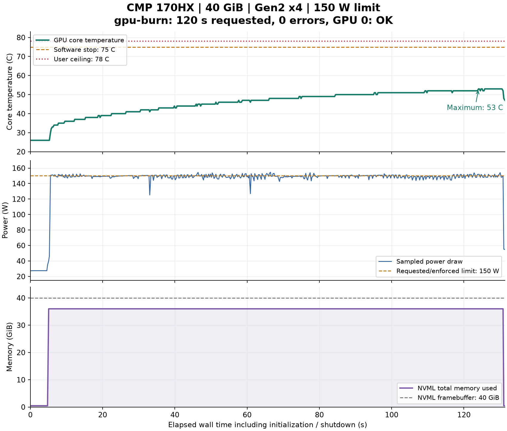
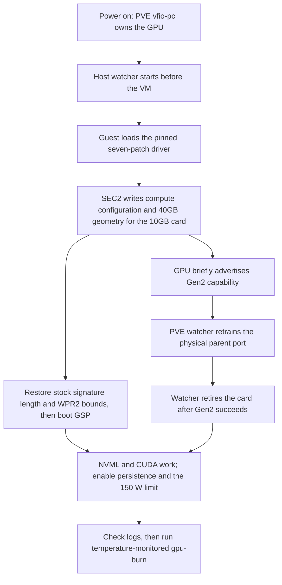

[](README.md) [](README.zh-CN.md)

# CMP 170HX 10GB → 40GB: A Successful Proxmox VFIO Reproduction

Repository: [Ciender/cmp170hx-40gb-proxmox-guide](https://github.com/Ciender/cmp170hx-40gb-proxmox-guide).

A single **CMP 170HX with PCI ID `10de:2082` and a stock capacity of 10GB** was brought up with **40960 MiB of framebuffer memory, PCIe Gen2 ×4, and 70 SMs** inside a **Debian 12 VM on Proxmox VE 8.4.1**. The setup uses Johnnydaboy's `homelab-dual-cmp170hx` branch and passed a short gpu-burn test with a **150 W power limit**.

This repository documents the successful path: the upstream fixes, pinned source versions, host and guest configuration, build procedure, cold power cycle, and measured results. The unlock implementation comes from upstream; this guide records its adaptation and verification on this particular 10GB card under PVE.

## Measured results

Validation date: **2026-11-14**.

| Item | Measured result |
| --- | --- |
| GPU | NVIDIA CMP 170HX, PCI ID `10de:2082` |
| Stock capacity / unlocked NVML capacity | 10GB / **40960 MiB** |
| CUDA-visible total capacity | **40483.625 MiB**; the difference from NVML includes driver and firmware reservations |
| CUDA compute capability / SM count | **8.0 / 70 SMs** |
| Physical PCIe link | **Gen2 ×4, 5 GT/s**, verified at both the GPU and its physical parent on PVE |
| BAR1 | **64 MiB** in the GPU's physical ReBAR state, PVE resources, and guest resources |
| Requested / enforced power limit | **150 W / 150 W** |
| gpu-burn | 120-second argument, about **35.31 GiB** allocated, **0 errors, GPU 0: OK** |
| Maximum GPU core temperature | **53°C** |
| Temperature monitoring | Approximately every 0.25 seconds; **stop early at 75°C**, with a required core-temperature ceiling of 78°C |
| Post-test logs | No guest Xid, GSP/BAR2 initialization failure, or kernel BUG/Oops found; host error screening was empty |
| ECC / additional 4 SMs | ECC reported `N/A`; the additional 4 SMs were not enabled |

This validates one card, one cold boot, and a 120-second gpu-burn run. It does not establish long-duration stability or provide an independent address-by-address test of the entire 40GB. gpu-burn's allocation, NVML's total memory usage, and CUDA's total capacity are recorded separately because they describe different quantities.



The plot comes from the [525 recorded telemetry samples](evidence/2026-11-14/temperature.csv). See the [validation report](docs/VALIDATION.md) for the complete evidence index and scope.

## Contents

- [The successful path and upstream fixes](#the-successful-path-and-upstream-fixes)
- [Pinned versions and hardware](#pinned-versions-and-hardware)
- [Record the PCI topology first](#record-the-pci-topology-first)
- [Prepare the PVE host](#prepare-the-pve-host)
- [Configure the VM](#configure-the-vm)
- [Build and install inside the Debian guest](#build-and-install-inside-the-debian-guest)
- [Perform a full cold power cycle](#perform-a-full-cold-power-cycle)
- [Verify the boot in order](#verify-the-boot-in-order)
- [Run gpu-burn with temperature protection](#run-gpu-burn-with-temperature-protection)
- [Ongoing maintenance](#ongoing-maintenance)
- [Repository contents and maintenance](#repository-contents-and-maintenance)

## The successful path and upstream fixes

The upstream general README still describes features such as full BAR1. The branch's [dedicated Proxmox guide](https://github.com/Johnnydaboy/cmpunlocker/blob/658110d5d1f15f7174d18f57caad4cab7d04593a/docs/proxmox-dual-cmp170hx.md) specifies a narrower VFIO configuration. This reproduction follows that guide and the actual default patch list in `driver/build.sh`.



**1. Keep BAR1 consistent with VFIO mappings.** QEMU establishes the guest BAR aperture when the VM is created. This branch leaves `bar1-resize-unlock.patch` out of the default build, avoiding a physical BAR1 resize through GPU registers that would disagree with existing QEMU/VFIO mappings. BAR1 remained 64 MiB throughout this successful 40GB boot and compute test. Framebuffer capacity does not require an equally large BAR1 aperture.

**2. Restore GSP signature length, WPR metadata, and WPR2 state correctly.** The pinned fix preserves the same signature memory descriptor, restores the original signature bytes, and sets the metadata length back to the actual signature length. The measured log reports `sigSize=4096`, rather than treating the `0xf800` payload buffer size as the signature length. Saved WPR2 hardware bounds are also restored after the SEC2 writes, with the relevant metadata flushed.

**3. Use the VFIO initialization path.** The CMP cards retain initialization locking instead of using relaxed parallel GSP initialization. The default patch list excludes `booter-verify.patch` and the guest-side `pcie-gen2-probe-retrain.patch`. The unrelated `FEAT_OVR_ECC_PLM` write at `0x00823800` was removed from `pcie-gen2.patch`. This reproduction did not add an ECC sequence back in.

**4. Retrain the physical link from PVE.** The guest's Q35 bridge and the host's real PCIe parent port are different layers. The upstream host watcher polls the physical GPU at a nominal 1 kHz, catches its brief Gen2 advertisement window during GSP initialization, sets the physical parent's target speed, and retrains the link. It retires the card once Gen2 is reached. In this run, the watcher caught the window at relative time `T+43.135` and reported Gen2 at `T+43.136`.

**5. Keep the high memory region reserved for WPR2.** The branch includes upstream fix `f51da03`, which stops re-registering the high reserved region with the PMA allocator. Here, `0x9f7500000–0x9ffffffff` remained reserved because it backs WPR2-related firmware storage. This fix comes from the original upstream project and its contributors; it should not all be attributed to Johnny.

See the [source analysis](docs/SOURCE-ANALYSIS.md) for the code changes, attribution, and the limits of what this run establishes.

## Pinned versions and hardware

### Source versions

| Purpose | Repository / branch | Pinned revision |
| --- | --- | --- |
| Guest unlock driver and host watcher C source | [Johnnydaboy/cmpunlocker](https://github.com/Johnnydaboy/cmpunlocker/tree/658110d5d1f15f7174d18f57caad4cab7d04593a), `homelab-dual-cmp170hx` | `658110d5d1f15f7174d18f57caad4cab7d04593a` |
| Companion PVE deployment guide and watcher unit | [Johnnydaboy/170hx-pve-gen2-controller](https://github.com/Johnnydaboy/170hx-pve-gen2-controller/tree/9ba9da505f64d2c1a56703edc9516f42712ec7d9), same branch name | `9ba9da505f64d2c1a56703edc9516f42712ec7d9` |
| NVIDIA base driver source | [NVIDIA/open-gpu-kernel-modules](https://github.com/NVIDIA/open-gpu-kernel-modules/tree/610.43.02) | Tag `610.43.02` |
| Stress test | [wilicc/gpu-burn](https://github.com/wilicc/gpu-burn/tree/0d19c94dcb2e9b6858b7586a4c327674cd67113b) | `0d19c94dcb2e9b6858b7586a4c327674cd67113b` |

### This machine

| Component | Value in this reproduction |
| --- | --- |
| Server / motherboard | XFUSION 2288H V6 / BC13MBSBH |
| BIOS version | 1.85, 2025-07-21 |
| PVE / host kernel / QEMU package | 8.4.1 / `6.8.12-11-pve` / `9.2.0-5` |
| Guest | Debian GNU/Linux 12, `6.1.0-51-amd64` |
| NVIDIA kernel modules, driver libraries, and GSP firmware | `610.43.02`; Debian package version `610.43.02-1` |
| CUDA Toolkit used to build gpu-burn | `13.3.1-1`; the comparison kernel was explicitly built as an `sm_80` cubin |
| Host GPU / physical parent | `0000:51:00.0` / `0000:50:02.0` |
| Guest GPU | `0000:02:00.0` |
| VM | 110, Q35 + OVMF, host CPU, 32000 MiB RAM, balloon=0 |

The author's dedicated guide validates **two `20c2` 8GB cards, 64GB per card, Gen2 ×8, and 180 W**. This reproduction uses **one `2082` 10GB card, 40GB, Gen2 ×4, and 150 W**. The author's dual-card inventory, PCI addresses, and 180 W helper were adapted accordingly.

## Record the PCI topology first

Run the following commands as root on the machine named in each section. The BDFs and VMID are values from this machine; discover them again after a motherboard or slot change.

On **PVE**, record:

```bash
lspci -Dnn | grep -i nvidia
lspci -Dnnk -s 0000:51:00.0
readlink -f /sys/bus/pci/devices/0000:51:00.0
find /sys/kernel/iommu_groups -type l | sort
qm config 110
cat /proc/cmdline
```

The GPU's sysfs path ends with:

```text
.../pci0000:50/0000:50:02.0/0000:51:00.0
```

Therefore, `50:02.0` on PVE owns the physical link retrain. The guest's `02:00.0` is used for its inventory and driver checks.

## Prepare the PVE host

### 1. Back up the existing configuration

Save `/etc/default/grub`, `/etc/kernel/cmdline` if used, `/etc/modprobe.d/`, `/etc/modules`, `/etc/initramfs-tools/modules`, the target VM configuration, and any existing watcher unit. Keep the original driver packages and source code.

IOMMU passthrough was already working on this host. The final successful setup did not change GRUB or BIOS settings. The effective command line already included:

```text
intel_iommu=on iommu=pt video=vesafb:off video=efifb:off initcall_blacklist=sysfb_init
```

Neither `pci=nocrs` nor `pci=realloc=off` was added. The framebuffer arguments were existing settings on this machine; their presence does not establish that every system needs them.

Firmware should meet the upstream requirements for IOMMU and Above-4G decoding. This run verified IOMMU groups and BAR addresses above 4 GiB, without separately inspecting the BIOS menu switches. **This path does not depend on enabling a 64 GiB ReBAR aperture.**

### 2. Bind the GPU to vfio-pci

Merge the following into the existing configuration, preserving IDs for other passed-through devices:

```text
# /etc/modprobe.d/vfio.conf
options vfio-pci ids=10de:2082

# /etc/modprobe.d/cmp170hx-vfio.conf
options vfio-pci disable_idle_d3=1

# /etc/modprobe.d/cmp170hx-host-blacklist.conf
blacklist nouveau
blacklist nvidia
blacklist nvidiafb
```

The actual host retained two other GPU IDs in `ids=`. Those unrelated IDs do not need to be copied. This host had no NVIDIA driver installed; the compute driver runs inside the guest.

Ensure `/etc/initramfs-tools/modules` includes:

```text
vfio
vfio_iommu_type1
vfio_pci
```

This `6.8.12-11-pve` setup does not use a separate `vfio_virqfd` module, so its obsolete entry was removed. Rebuild the initramfs for the running host kernel:

```bash
update-initramfs -u -k "$(uname -r)"
```

### 3. Install the original upstream Gen2 watcher

`third_party/cmp-gen2-watch/cmp-gen2-watch.c` is the unmodified file from the pinned upstream revision. Its SHA256 is:

```text
d39d2b76dfac1b63c8af9efe7857055c3f5d1873184f8b3eea1aaa7d0304710e
```

Assuming this repository is at `/root/cmp170hx-40gb-proxmox-guide`, run on **PVE**:

```bash
cd /root/cmp170hx-40gb-proxmox-guide
install -d /usr/local/src /usr/local/sbin /usr/local/libexec
install -m 0644 third_party/cmp-gen2-watch/cmp-gen2-watch.c /usr/local/src/cmp-gen2-watch.c
cc -O2 -Wall -Wextra -o /usr/local/sbin/cmp-gen2-watch /usr/local/src/cmp-gen2-watch.c
install -m 0755 scripts/cmp170hx-verify-topology.py /usr/local/libexec/cmp170hx-verify-topology
install -m 0644 configs/host/cmp-gen2-watch.service /etc/systemd/system/cmp-gen2-watch.service
/usr/local/libexec/cmp170hx-verify-topology
systemd-analyze verify /etc/systemd/system/cmp-gen2-watch.service
systemctl daemon-reload
systemctl enable cmp-gen2-watch.service
```

The added pre-start check reads topology only: there must be exactly one supported CMP, it must be an `2082` at `51:00.0 → 50:02.0`, and it must already use `vfio-pci`. These checks match this machine. If addresses change, update `scripts/cmp170hx-verify-topology.py` before installation rather than bypassing the check.

The unit starts before `pve-guests.service`, polls every 1 ms, and runs for at most five minutes. **Enable** it during preparation and let the full cold boot start it. It writes real PCIe configuration space and should not be started casually as a status query.

This reproduction used the standalone watcher for Gen2 timing. The companion repository's optional vsock status transport and `vfio-linkd` daemons were not deployed.

## Configure the VM

The relevant settings are below; see [configs/host/vm110.conf.example](configs/host/vm110.conf.example) for the configuration excerpt:

```text
bios: ovmf
machine: q35
cpu: host,phys-bits=host
memory: 32000
balloon: 0
hostpci1: 0000:51:00,pcie=1
args: -global q35-pcihost.pci-hole64-size=512G -fw_cfg name=opt/ovmf/X-PciMmio64Mb,string=262144
onboot: 1
```

`hostpci1` is used because `hostpci0` was already assigned to another device. Add the target GPU entry without replacing other devices. The GPU entry has no `x-vga=1`; a virtual console remains available for troubleshooting.

The 512 GiB PCI hole and 256 GiB OVMF MMIO window were existing settings retained for the successful boot. **Their minimum required sizes were not measured.** These case-specific values are not established universal requirements. Merge an existing `args:` line instead of adding a second key that replaces its contents.

Enable VM autostart on PVE so the guest starts within the watcher's five-minute window:

```bash
qm set 110 --onboot 1
```

The guest must allow custom kernel modules to load; upstream requires Secure Boot to be disabled. Host and guest Secure Boot EFI variables were not independently read in this run. The presence of pre-enrolled OVMF keys is not itself a measurement of the active Secure Boot state.

## Build and install inside the Debian guest

### 1. Match the libraries, firmware, and kernel module version

Install build dependencies inside the **guest**:

```bash
apt-get update
apt-get install -y build-essential git curl patch python3 libelf-dev binutils linux-headers-"$(uname -r)"
```

Upstream `driver/build.sh` downloads and builds kernel modules. **It does not install matching userspace driver libraries or GSP firmware.** The packages in this reproduction came from NVIDIA's Debian 12 CUDA repository and were pinned to `610.43.02-1`. See the complete installed version list in [userspace-packages.txt](evidence/2026-11-14/userspace-packages.txt).

On Debian 12 with that package repository already configured, first simulate dependency resolution:

```bash
apt-get -s install nvidia-driver-cuda=610.43.02-1 libcuda1=610.43.02-1 libnvidia-ml1=610.43.02-1 firmware-nvidia-gsp=610.43.02-1 nvidia-persistenced=610.43.02-1
```

Install those exact package versions only after confirming they remain available and the dependency plan does not mix driver branches. An unversioned `apt install nvidia-driver` is not the procedure used here. The final setup uses manually installed unlock modules with the stock DKMS kernel-module package removed. Check whether library installation reintroduces DKMS modules and resolve module replacement before building. This guide specifies the verified package versions without assuming a future APT repository will retain them.

```bash
dpkg-query -W -f='${Package} ${Version}\n' firmware-nvidia-gsp libcuda1 libnvidia-ml1 nvidia-driver-cuda nvidia-persistenced
dkms status
```

Matching packages were retained locally, and related driver packages were held to prevent library/module drift during upgrades. CUDA Toolkit, used to compile gpu-burn, is a separate component from these NVIDIA driver packages.

### 2. Check out the pinned branch and commit

```bash
git clone --branch homelab-dual-cmp170hx --single-branch https://github.com/Johnnydaboy/cmpunlocker.git /root/cmpunlocker-vfio
cd /root/cmpunlocker-vfio
git checkout --detach 658110d5d1f15f7174d18f57caad4cab7d04593a
git status --short
cat driver/VERSION
```

The supported list contains `610.57.04`, `610.43.03`, and `610.43.02`. The first entry is the default, so explicitly set `CMPUNLOCKER_DRIVER_VERSION=610.43.02` for this reproduction.

### 3. Use the seven default patches

```text
sec2-postbl-plm-ss-cfg.patch
late-pma.patch
bar0-pramin-clamp.patch
ce-scrub-workarounds.patch
persistent-sw-state.patch
pcie-gen2.patch
name-string.patch
```

Set `CMPUNLOCKER_ENABLE_BAR1_RESIZE=0`. This build did not add `booter-verify`, guest probe retraining, an additional 4 SMs, or an ECC sequence. The upstream driver patches were used without local modifications.

### 4. Verify the NVIDIA source archive

```bash
install -d /root/cmpunlocker-build-610.43.02-10gb
curl -L --fail -o /root/cmpunlocker-build-610.43.02-10gb/open-gpu-kernel-modules-610.43.02.tar.gz https://github.com/NVIDIA/open-gpu-kernel-modules/archive/refs/tags/610.43.02.tar.gz
echo '62fbbe29527e30be32cb38b30dfad2e94db1ca87f77a58090e563c7669857e60  /root/cmpunlocker-build-610.43.02-10gb/open-gpu-kernel-modules-610.43.02.tar.gz' | sha256sum -c -
```

In this run, patch application and compilation were checked offline first. The original `driver/build.sh` then reused that same build tree for installation. The command below applies the same environment settings to a source build; readers do not need to fabricate or copy a build stamp.

### 5. Build with Debian's split kernel headers

On this Debian installation, the kernel source headers and output headers reside in `/lib/modules/<kernel>/source` and `/lib/modules/<kernel>/build`, respectively. Pass the correct paths through GNU make command-line variables, leaving the upstream script unchanged:

```bash
cd /root/cmpunlocker-vfio
KVER="$(uname -r)"
test -d "/lib/modules/${KVER}/source"
test -d "/lib/modules/${KVER}/build"

env \
  MAKEFLAGS="KERNEL_SOURCES=/lib/modules/${KVER}/source SYSOUT=/lib/modules/${KVER}/build" \
  CCACHE_DISABLE=1 \
  CMPUNLOCKER_DRIVER_VERSION=610.43.02 \
  CMPUNLOCKER_BUILD_DIR=/root/cmpunlocker-build-610.43.02-10gb \
  CMPUNLOCKER_SKIP_RELOAD=1 \
  CMPUNLOCKER_ENABLE_BAR1_RESIZE=0 \
  CMPUNLOCKER_CARD_PROFILE=10gb \
  CMPUNLOCKER_GPU_INVENTORY='0000:02:00.0 2082 10gb 40960' \
  taskset -c 0-7 bash driver/build.sh
```

`taskset -c 0-7` limits compilation to the eight CPUs used here; choose CPU IDs allowed on your machine. The essential installation option is `CMPUNLOCKER_SKIP_RELOAD=1`: install modules, update initramfs, and exit while waiting for a full cold power cycle.

For PCI ID `2082`, the patched runtime code selects `CFG1=0x02669000`, `LMR=0x28A`, and `fbSize=0xA00000000`. The inventory also explicitly records one 10GB card targeting 40960 MiB.

After installation, check the module location and metadata:

```bash
modinfo -n nvidia
modinfo -F version nvidia
modinfo -F vermagic nvidia
cat "/lib/modules/${KVER}/updates/cmpunlocker/gpu_inventory"
readelf -n "/lib/modules/${KVER}/updates/cmpunlocker/nvidia.ko"
```

This run's `nvidia.ko` has GNU build ID `9cd455a800b99662e649abc4ed52189b1136b1f7` and SHA256 `e72edc956c867814ab1379b8f7bcc876101ae4abaa60aff6cd0c354661a12f82`. These identify this particular artifact; correct builds from a different compilation environment need not have identical binary hashes. All five modules are recorded in [build-manifest.json](evidence/2026-11-14/build-manifest.json).

### 6. Retain guest options and install the single-card 150 W service

The guest retained these Gen2 registry options:

```text
# /etc/modprobe.d/cmp-pcie-gen2.conf
options nvidia NVreg_RegistryDwords="RmForceEnableGen2=1;RMPcieLinkSpeed=0x1"
```

Merge this with existing NVIDIA options so multiple files do not overwrite the same registry parameter. The old guest polling/retraining `gen2.service` and hammer were disabled; the PVE watcher owns physical retraining.

The 150 W helper identifies one card by UUID, enables persistence, sets the power limit, and verifies requested/enforced limits twice. The published copy externalizes the machine-specific UUID while retaining the helper logic used in this run.

```bash
cd /root/cmp170hx-40gb-proxmox-guide
install -d /etc/cmp170hx
install -m 0755 scripts/cmp170hx-power-limit.py /usr/local/sbin/cmp170hx-power-limit
install -m 0644 configs/guest/cmp170hx-power-limit.service /etc/systemd/system/cmp170hx-power-limit.service
install -m 0644 configs/guest/power.env.example /etc/cmp170hx/power.env
# Edit power.env and set CMP170HX_GPU_UUID to the card's previously recorded UUID.
systemctl daemon-reload
systemctl enable cmp170hx-power-limit.service
update-initramfs -u -k "$(uname -r)"
```

Use a UUID recorded earlier during preparation. Do not repeatedly request initialization from an already failed driver just to obtain a UUID. The author's example helper waits for two cards and sets 180 W; this reproduction uses the single-card 150 W helper instead.

## Perform a full cold power cycle

After preparation:

1. Shut down the target guest normally.
2. Shut down the entire PVE host normally.
3. Disconnect every PSU power input and wait at least 30 seconds.
4. Restore power and boot. Let the PVE watcher start first and the VM autostart afterward.

This is the power sequence required by the upstream deployment guide. After power was restored, measurements confirmed 64 MiB BAR1 state at the GPU, PVE, and guest. A changed guest boot ID alone does not establish that physical GPU state has been cleared.

## Verify the boot in order

### 1. Guest: preserve the first initialization log

```bash
journalctl -k -b --no-pager > /root/cmp170hx-current-boot.log
grep -En 'RmInitAdapter failed|MMUTest.*returned garbage|Cannot initialize GSP firmware|Booter failed with non-zero error code: 0x(15|0?b)|NVRM: Xid|(^|[[:space:]])BUG:|(^|[[:space:]])Oops:' /root/cmp170hx-current-boot.log
```

An empty result with grep exit status 1 means none of these failure patterns matched. If there is output, preserve the first error. `SEC2_DEBUG:` is a debug prefix; a bare `BUG:` substring check would misclassify it as a kernel BUG. Upstream documents Booter response `0x31` during the SEC2 exploit as expected.

If initialization has failed, stop further NVML query loops, stress tests, and live driver unloads. Diagnose the first error, then verify changes with another full cold power cycle.

### 2. PVE: check the physical link and BARs

```bash
tail -100 /var/log/cmp-gen2-watch.log
lspci -nnvv -s 0000:51:00.0
lspci -nnvv -s 0000:50:02.0
cat /sys/bus/pci/devices/0000:51:00.0/current_link_speed
cat /sys/bus/pci/devices/0000:51:00.0/current_link_width
cat /sys/bus/pci/devices/0000:50:02.0/current_link_speed
cat /sys/module/vfio_pci/parameters/disable_idle_d3
```

Key output from this run:

```text
T+43.135 0000:51:00.0 flip detected (speed nibble 2) -> retrain via 0000:50:02.0
T+43.136 0000:51:00.0 trained at Gen2; retiring watcher for this card
# all cards reached Gen2; exiting
# 0000:51:00.0 final LnkSta=1042 (GEN2+)
```

`1042` is this endpoint's raw link-status value, not a universal expected constant; this machine uses ×4. The watcher becoming inactive after success is normal. Its exit code alone does not establish Gen2: inspect the log and actual link speed/width.

In PVE's `lspci -vv` output, check both `Region 1 ... [size=64M]` and BAR1 `current size: 64MB` under `Physical Resizable BAR`. This run's physical BAR1 spans `0xd2ff8000000–0xd2ffbffffff`; BAR3 starts at `0xd2ffc000000`, with no overlap.

### 3. Guest: verify the driver, memory, and power limit

```bash
systemctl status cmp170hx-power-limit.service --no-pager
nvidia-smi --query-gpu=name,driver_version,memory.total,persistence_mode,power.limit,enforced.power.limit,pcie.link.gen.current,pcie.link.width.current --format=csv
```

Measured result:

```text
NVIDIA CMP 170HX, 610.43.02, 40960 MiB, Enabled, 150.00 W, 150.00 W, 2, 4
```

`modinfo` describes the module on disk. To verify that the loaded image is the same build, compare `/sys/module/nvidia/notes/.note.gnu.build-id` with the module ELF's GNU build ID, or use [check_loaded_module.py](scripts/check_loaded_module.py). Version or srcversion alone cannot distinguish every RM patch change.

## Run gpu-burn with temperature protection

### 1. Build the pinned revision

Inside the **guest**, install CUDA Toolkit with its headers and cuBLAS; the default path here is `/usr/local/cuda`. This run used Toolkit 13.3.1. Build the comparison kernel directly as an `sm_80` cubin:

```bash
git clone https://github.com/wilicc/gpu-burn.git /root/gpu-burn
cd /root/gpu-burn
git checkout --detach 0d19c94dcb2e9b6858b7586a4c327674cd67113b
make -j8 COMPUTE= NVCCFLAGS='-gencode=arch=compute_80,code=sm_80' CUDAPATH=/usr/local/cuda
```

### 2. Check monitoring before starting the load

The required GPU core-temperature ceiling was **78°C**. The monitor stops early at **75°C**. It also terminates the entire load process group if monitoring fails, telemetry is more than one second old, requested/enforced limits cease to be 150 W, gpu-burn reports an error, or the run exceeds its deadline. Software polling and termination cannot guarantee the absence of a brief overshoot when sensor updates are delayed or hardware malfunctions.

The published `scripts/guarded_gpu_burn.py` takes the UUID, gpu-burn directory, and output directory from environment variables. It retains the tested 120-second, 90%-memory, 75°C policy. Without `--run`, it performs monitoring preflight only.

```bash
cd /root/cmp170hx-40gb-proxmox-guide
export GPU_BURN_REPO=/root/gpu-burn
export CMP170HX_GPU_UUID='GPU-REPLACE-WITH-YOUR-CARD-UUID'
export CMP170HX_RESULT_DIR="/root/cmp170hx-burn-$(date +%Y%m%d-%H%M%S)"

python3 scripts/guarded_gpu_burn.py

systemd-run --unit="cmp170hx-burn-$(date +%Y%m%d-%H%M%S)" \
  --property=RuntimeMaxSec=150s \
  --property=TimeoutStopSec=1s \
  --property=KillMode=control-group \
  --setenv="GPU_BURN_REPO=${GPU_BURN_REPO}" \
  --setenv="CMP170HX_GPU_UUID=${CMP170HX_GPU_UUID}" \
  --setenv="CMP170HX_RESULT_DIR=${CMP170HX_RESULT_DIR}" \
  --wait --pipe \
  /usr/bin/python3 -u /root/cmp170hx-40gb-proxmox-guide/scripts/guarded_gpu_burn.py --run
```

Use a new output directory to preserve previous evidence. During the test, keep the power service and memory clocks unchanged and avoid concurrent GPU workloads.

### 3. Results from this run

```text
Initialized device 0 with 40483 MB of memory
(40179 MB available, using 36161 MB of it), using FLOATS
Results are 268435456 bytes each, thus performing 139 iterations
...
errors: 0
Tested 1 GPUs:
    GPU 0: OK
```

The gpu-burn argument was 120 seconds. Including initialization and shutdown, elapsed wall time was **131.451 seconds**, with 1112 matrix multiplications reported in total. Core temperature peaked at **53°C**; a subsequent idle query reported **32°C**. Peak NVML total memory usage was **36876.3125 MiB**, which includes more than gpu-burn's own 36161 MiB allocation.

Requested and enforced limits remained 150 W in every sample. The highest instantaneous power reading was **154.659 W**. A driver power limit is a control target, not a hard cap on every instantaneous sample.

## Ongoing maintenance

These modules are installed manually under the current kernel's `updates/cmpunlocker` directory; DKMS does not maintain them automatically. After changing the guest kernel, rebuild against its headers, update initramfs, and repeat the cold-boot acceptance sequence. This binary's vermagic does not make it suitable for another kernel.

Keep NVIDIA kernel modules, userspace libraries, and GSP firmware on matching versions. This guide validates only the pinned combination above. Record results separately after a driver or platform change instead of carrying forward this run's success status. Continue monitoring core temperature during future tests: the ceiling for this setup is 78°C, with an early-stop threshold of 75°C.

## Repository contents and maintenance

```text
README.md                          Complete English reproduction guide (default)
README.zh-CN.md                    Complete Simplified Chinese guide
docs/SOURCE-ANALYSIS.md             Fix mechanisms, source revisions, and attribution
docs/VALIDATION.md                  Results, evidence index, and validation scope
docs/PUBLISHING.md                  Clone, check, and maintain the repository
docs/*.zh-CN.md                    Chinese versions of the supporting guides
configs/host/                      PVE units, VFIO, and VM configuration examples
configs/guest/                     Single-card 150 W unit and configuration example
scripts/                          Topology, module, power, and temperature helpers
third_party/cmp-gen2-watch/         Original upstream watcher and license
evidence/2026-11-14/                Successful run logs, telemetry, and build manifest
assets/                           Measured telemetry plot and language buttons
tools/verify_evidence.py           Offline verification of the cited measurements
```

GPU UUIDs and hostnames have been redacted for publication. The repository contains no SSH credentials, private network addresses, chat history, full system backups, or NVIDIA driver binaries. PCI BDFs remain as case-specific values needed to explain this topology.

Run `python3 tools/verify_evidence.py` to check the evidence offline. See [PUBLISHING.md](docs/PUBLISHING.md) for cloning and maintenance instructions.

## Sources and acknowledgments

- [amoghmunikote/cmpunlocker](https://github.com/amoghmunikote/cmpunlocker): the original unlock project and upstream contributions.
- [Johnnydaboy/cmpunlocker](https://github.com/Johnnydaboy/cmpunlocker/tree/658110d5d1f15f7174d18f57caad4cab7d04593a): the VFIO fix branch and dedicated deployment guide used here.
- [Johnnydaboy/170hx-pve-gen2-controller](https://github.com/Johnnydaboy/170hx-pve-gen2-controller/tree/9ba9da505f64d2c1a56703edc9516f42712ec7d9): companion physical-link deployment guide and unit source.
- [cmpunlocker PR #35](https://github.com/amoghmunikote/cmpunlocker/pull/35): the foundation credited by the watcher source; this guide does not claim to validate the PR's other changes as an additional path.
- [NVIDIA/open-gpu-kernel-modules](https://github.com/NVIDIA/open-gpu-kernel-modules/tree/610.43.02): base driver source.
- [wilicc/gpu-burn](https://github.com/wilicc/gpu-burn/tree/0d19c94dcb2e9b6858b7586a4c327674cd67113b): stress-test tool.

Original documentation and helper scripts use the MIT license. Third-party files retain their own licenses and attribution; see [NOTICE.md](NOTICE.md).
